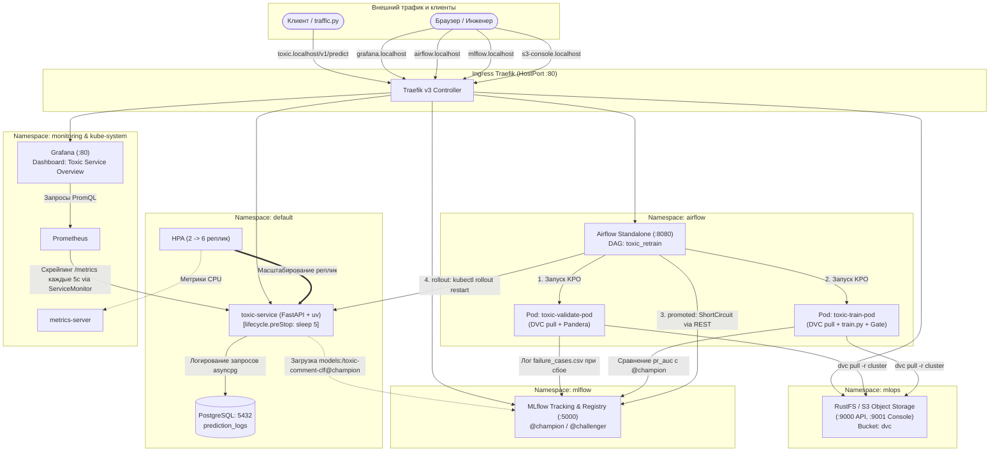

# Итоговый отчёт по домашнему заданию №4 (Production Retraining & Monitoring)

---

## 1. Архитектурная схема системы

Ниже представлена полная схема взаимодействия компонентов платформы, микросервиса, конвейера переобучения и мониторинга:

## 2. Кто что хранит (хранение артефактов и версионирование)

| Сущность | Где физически хранится | Как найти нужную версию |
|---|---|---|
| Исходный код и манифесты | GitHub-репозиторий (git) | По SHA коммита, ветке `main` или релизному тегу |
| Данные (сырые датасеты) | Хранилище S3 RustFS в кластере (`s3://dvc/files/md5/`) | По md5-хэшу в файле указателя `data/train.csv.dvc` в Git |
| Указатели данных (`.dvc`) | Git-репозиторий и Docker-образ (`data/train.csv.dvc`) | Привязаны к коммиту Git, фиксируют точный хэш датасета |
| Модели (веса, артефакты, PR-кривые) | MLflow Tracking Server (PersistentVolumeClaim: `mlflow-pvc`) | По номеру версии (Version N) или алиасам (`@champion`, `@challenger`) в реестре `toxic-comment-clf` |
| Docker-образы | GitHub Packages (GHCR) | По тегу SHA коммита (`ghcr.io/volkovaia/mlops_1:<sha>`) или `latest` |
| Логи запросов и инференса | PostgreSQL (таблица `prediction_logs`) | По первичному ключу `request_id` (UUID), временной метке `timestamp` или `model_version` |

## 3. Пункт задания — доказательство

| Пункт задания | Доказательство (ссылка / файл) | Комментарий |
|---|---|---|
| **4.1. Quickstart и платформа одной командой** | Раздел Quickstart в `README.md`; `docs/screenshots/01_platform_running_pods.png` | Вывод `kubectl get pods -A` — все поды в статусе Running. Подъём с нуля занял 4 минуты 30 секунд. |
| **4.2. Метрики и дашборд Grafana под трафиком** | `docs/screenshots/05_grafana_dashboard_under_traffic.png`, `docs/screenshots/09_grafana_dashboard_retrain.png` | 4 панели: RPS (~13–15), p50/p95 latency (12–25 ms), гистограмма распределения скоров, активная версия в подах. |
| **4.3. Данные в DVC и S3 кластера** | Файл `data/train.csv.dvc` в Git; `docs/screenshots/10_s3_dvc_bucket.png` | В образе только указатель (вывод `docker run --rm toxic-service:latest ls -la data` подтверждает отсутствие `train.csv`). Бакет `dvc` в консоли S3. |
| **4.4. Валидация данных через Pandera** | `tests/test_validation.py` (зелёные тесты в CI); `docs/screenshots/11_mlflow_failure_cases.png` | Прогон `validate` в MLflow с тегом `valid=false` и открытым артефактом `failure_cases.csv` при порче данных. |
| **4.5. Сценарий 1 Airflow (Новая модель лучше)** | `docs/screenshots/06_airflow_scenario1_success.png` | Все 4 задачи `validate -> train -> promoted -> rollout` тёмно-зелёные (success). Версия в продакшене переключилась. |
| **4.5. Сценарий 1 Airflow (Новая модель лучше)** | `docs/screenshots/06_01_airflow_scenario1_success.png` | Все 4 задачи `validate -> train -> promoted -> rollout` тёмно-зелёные (success). Версия в продакшене переключилась. |
| **4.5. Сценарий 2 Airflow (Гейт не пустил модель)** | `docs/screenshots/07_airflow_scenario2_rejected.png` | Модель обучена со слабым параметром, гейт отклонил её, `promoted` вернул `False`, задача `rollout` переведена в `Skipped`. |
| **4.5. Сценарий 3 Airflow (Плохие данные)** | `docs/screenshots/08_airflow_scenario3_bad_data.png` | Значение в данных повреждено (`toxic=9`). Задача `validate` упала красным `Failed`, downstream-задачи заблокированы, сервис продолжил работу на прежней версии. |
| **4.5. Model Registry с колонкой Aliases** | `docs/screenshots/02_model_registry_aliases.png` | Таблица версий модели `toxic-comment-clf` с колонкой Aliases (`@champion` и `@challenger`). |
| **4.5. Model Registry с колонкой Aliases** | `docs/screenshots/02_01_model_registry_aliases.png` | Таблица версий модели `toxic-comment-clf` с колонкой Aliases (`@champion` и `@challenger`). |
| **4.6. CI/CD целиком на Self-Hosted Runner** | Ссылка на прогон в GitHub Actions: `https://github.com/volkovaia/mlops_1/actions/runs/38635724209` | Все 3 джобы (`tests`, `build`, `deploy`) зелёные. В логе виден runner `local-kind-runner`, шаг мониторинга и ConfigMap DAG, 4 проверки Smoke-теста через Ingress. |

## 4. Разбор трёх сценариев переобучения в Airflow

### Сценарий 1: Успешное переобучение и выкат 

`docs/screenshots/06_scenario1_success.png`
`docs/screenshots/06_01_scenario1_success.png`
- **Граф DAG:** все задачи (`validate`, `train`, `promoted`, `rollout`) завершились со статусом `success`.
- **Гейт качества:** модель обучена с параметром `C=20.0` и достигла `PR-AUC: 0.9945`, что превзошло предыдущего чемпиона (`0.9942`) с запасом, превышающим порог `MIN_GAIN = 0.0001`. Модели присвоен алиас `@champion`.
- **Zero-Downtime Rollout:** во время перезапуска деплоймента параллельно работал генератор `scripts/traffic.py` (~14 RPS). Благодаря `lifecycle.preStop` (sleep 5) и `readinessProbe` зафиксировано 0 ошибок соединения и 0 ответов со статусом 5xx. Версия на панели Grafana сменилась на новую.

### Сценарий 2: Отклонение модели валидационным гейтом

`docs/screenshots/07_scenario2_rejected.png`
- **Граф DAG:** задачи `validate`, `train`, `promoted` зелёные, задача `rollout` розовая.
- **Поведение:** модель обучена со слабым коэффициентом регуляризации, набрала `PR-AUC: 0.9514` против `0.9945` у чемпиона.
- **Результат:** гейт не выдал алиас `@champion`, оставив модель только со статусом `@challenger`. `ShortCircuitOperator` в задаче `promoted` вернул `False`, отменив выкат. Поды в продакшене не перезапускались.

### Сценарий 3: Блокировка конвейера при деградации данных

`docs/screenshots/08_scenario3_bad_data.png`
`docs/screenshots/11_mlflow_failure_cases.png`
- **Граф DAG:** задача `validate` завершилась с ошибкой. Задачи `train`, `promoted`, `rollout` перешли в статус `Ошибка выполнения вышестоящей задачи` и не запускались.
- **Поведение:** в обучающую выборку внесено недопустимое значение целевого класса (`toxic = 9`). Pandera зафиксировала нарушение контракта схемы `Check.isin([0, 1])`, сохранила отчёт `failure_cases.csv` и отправила его артефактом в MLflow (эксперимент `data-validation`, тег `valid=false`).
- **Откат:** выполнен значение исправлено обратно на 1, `uv run dvc add data/train.csv` и `uv run dvc push -r laptop`. При следующем прогоне DAG вернулся в зелёный статус.

## 5. Ответы на восемь вопросов

### 1. У вас в реестре версия N модели. По шагам: как восстановить ровно тот код и те данные, на которых она обучена? Какие поля прогона MLflow и какие файлы в git для этого нужны?

В MLflow Model Registry открываем версию `N` и переходим в связанный прогон (Run). В параметрах прогона берём два значения: `git_commit` (SHA коммита исходного кода) и `data_md5` (хэш датасета). В Git переключаемся на зафиксированный код: `git checkout <git_commit>`. Для восстановления данных находим коммит, где файл `data/train.csv.dvc` содержал этот хэш, и выполняем `git checkout <commit> -- data/train.csv.dvc`, после чего стягиваем точный срез данных из S3 командой `uv run dvc checkout`.

### 2. Почему данные не в образе, а указатели в образе? Что сломается, если сделать `git push` раньше `dvc push`, и где вы это увидите?

Данные не упаковывают в Docker-образ, чтобы не храздувать его размер до десятков гигабайт, сохранять скорость CI/CD и разграничить жизненный цикл кода и данных. Файл-указатель `.dvc` весит менее 100 байт и однозначно определяет версию. Если сделать `git push` раньше `dvc push`, в репозиторий попадёт хэш данных, которых физически ещё нет в центральном хранилище S3. При сборке или запуске в кластере под выполнит `dvc pull -r cluster` и упадёт с ошибкой, что отобразится в логах пода `validate` в Airflow или раннера CI.

### 3. Какие проверки вашей схемы бинарные, а какие с порогом? Как выбирали порог и что будет, если он слишком строгий?

**Бинарные проверки:** проверка типов данных (строка для текста, `int` для класса), допустимые значения класса `Check.isin([0, 1])`, ограничение длины текста (от 1 до 10000 символов) и отсутствие `null`-значений (`nullable=False`). **Проверки с порогом:** минимальный объём выгрузки (не менее 1000 строк) и доля токсичного класса `toxic_rate` в границах `[0.01, 0.90]`. Порог доли класса выбран исходя из здравого смысла: в реальных комментариях токсичность составляет 8–15%, поэтому падение ниже 1% означает потерю целевого класса при фильтрации, а рост выше 90% — аномальный сдвиг выборки. Если порог сделать слишком строгим, то естественные колебания трафика будут приводить к ложным срабатываниям и постоянным падениям конвейера переобучения.

### 4. Чем проверка pandera в конвейере отличается от Pydantic-схемы в сервисе? Зачем нужны обе?

Pydantic валидирует одиночные поступающие запросы непосредственно в момент Serving (online): проверяет структуру JSON, типы входных полей сырого текста и запрещает лишние поля, предотвращая падение микросервиса от некорректного payload. Pandera валидирует исторические массивы данных в конвейере обучения: проверяет распределения колонок, агрегированные статистики, баланс классов и процент пропусков во всей выборке. Обе проверки необходимы: Pydantic защищает микросервис от поломок на этапе инференса, а Pandera защищает модель от обучения на испорченных или смещённых данных.

### 5. Почему обучение идёт в отдельном поде из образа сервиса, а не внутри Airflow? Почему выкат новой модели не требует пересборки образа?

Обучение вынесено в изолированный под через `KubernetesPodOperator`, чтобы воркер Airflow не деградировал по CPU/памяти при больших вычислениях, а также ради изоляции зависимостей (тяжёлые scikit-learn, MLflow, Pandera не утяжеляют платформенный под оркестратора). Выкат новой модели не требует пересборки Docker-образа, так как приложение загружает веса динамически при старте из MLflow Model Registry по фиксированному алиасу `models:/toxic-comment-clf@champion`. Переключение модели происходит на уровне реестра, после чего `rollout restart` быстро обновляет поды.

### 6. Какие метрики на вашем дашборде про инфраструктуру, какие про сервис, какие про модель? Почему `request_id` нельзя класть в метку Prometheus?

**Инфраструктурные метрики:** использование CPU/памяти подами, статус реплик Deployment, сетевой трафик. **Метрики сервиса:** RPS (запросы в секунду через `http_requests_total`), перцентили задержки ответов p50 и p95 (`http_request_duration_seconds_bucket`). **Метрики модели:** версия активной модели в поде (`toxic_model_info`), распределение вероятности токсичности (`toxic_prediction_score`). `request_id` запрещено класть в метки Prometheus, так как это уникальный идентификатор с бесконечной кардинальностью. Это приведёт к экспоненциальному разрастанию базы временных рядов Prometheus, переполнению памяти и падению мониторинга (OOMKilled).

### 7. Что происходит с подами и с запросами во время выката новой модели? Зачем `preStop` и что вы видели без него?

Во время Rolling Update контроллер создаёт новые поды с новой моделью. Они проходят `startupProbe` и `readinessProbe`, и только после статуса Ready Traefik начинает направлять на них трафик. Одновременно старым подам посылается сигнал SIGTERM. Без хука `preStop` под удаляется из Endpoints контроллера с задержкой в доли секунды; если под мгновенно завершит процесс, запросы, уже летящие по TCP-соединению, завершатся ошибками 502 Bad Gateway или Connection Reset. Хук `lifecycle.preStop.exec.command: ["/bin/sh", "-c", "sleep 5"]` приостанавливает выключение контейнера на 5 секунд, давая Ingress-контроллеру время исключить под из маршрутизации и позволяя сервису дообработать активные HTTP-запросы без потерь.

### 8. Какой отказ вашего проекта в проде самый вероятный? Где и через сколько вы его заметите и что сделаете первым?

Самый вероятный отказ — падение MLflow Tracking Server или недоступность S3/Postgres во время ночного переобучения (либо OOMKilled пода валидации при резком кратном росте объёма данных). В продакшене инференса наиболее вероятен всплеск задержки из-за наплыва длинных текстов, приводящих к долгой векторизации TF-IDF. Это проявится на дашборде Grafana (панель Latency p95 превысит порог в 100 мс) и через алерты Alertmanager в течение 15–30 секунд (период сбора метрик ServiceMonitor — 5 секунд). Первое действие: проверить HPA (`kubectl get hpa`), при необходимости временно поднять минимальное число реплик сервиса (`kubectl scale deploy/toxic-service --replicas=4`) и изучить логи подов (`kubectl logs`).

## 6. Журнал проблем

### 1. Ошибка резолвинга DNS RustFS в подах Airflow

- Задача `validate` падала с `ERROR: failed to connect to s3 (dvc/files/md5) - Could not connect to the endpoint URL: "http://rustfs.mlops:9000/dvc/files/md5"`.
- **Причина:** манифест RustFS/S3 отсутствовал в кластере, пространство имён `mlops` не существовало.
- **Решение:** создан манифест `platform/rustfs.yaml` на базе легковесного образа `rustfs/rustfs:latest`, сервис развёрнут в неймспейсе `mlops` на порту 9000, в кластере создан бакет `dvc`, и датасет успешно отправлен через `dvc push -r laptop`.

### 2. Специфика импорта образов `kind load` на Windows (content digest not found)

- `kind load docker-image` падал с ошибкой `ctr: content digest sha256:... not found`.
- **Причина:** Docker Desktop на Windows выкачивает только нативную платформу хоста, а утилита `kind` пытается импортировать все архитектуры (`--all-platforms`).
- **Решение:** загрузка образов выполнена через tar-архив и прямой импорт в containerd ноды: `docker exec mlpro-cluster-control-plane ctr --namespace=k8s.io images import ...`.

### 3. Ошибка `NameError: name 'os' is not defined` в `data.py`

- Ппод валидации падал на шаге чтения переменной `os.getenv("MLFLOW_TRACKING_URI")`.
- **Причина:** в модуле `src/toxic_service/data.py` отсутствовал импорт библиотеки `os`.
- **Решение:** добавлен `import os`, задан корректный внутрикластерный адрес `http://mlflow.mlflow.svc.cluster.local:5000`, образ пересобран и загружен в кластер.

### 4. Невалидный ключ в ConfigMap (`dags/toxic_retrain.py`)

- `kubectl create configmap airflow-dags --from-file=dags/...` возвращал ошибку валидации имени ключа из-за наличия символа слеша `/`.
- **Причина:** Kubernetes ConfigMap не допускает слеши в именах ключей файла.
- **Решение:** команда скорректирована на явное задание ключа: `--from-file=toxic_retrain.py=dags/toxic_retrain.py`.

### 5. Отсутствие утилиты `kubectl` в поде Airflow

- Задача `rollout` завершалась с кодом 127: `/usr/bin/bash: line 1: kubectl: command not found`.
- **Причина:** стандартный образ `apache/airflow:3.3.2` не содержит CLI-клиента Kubernetes.
- **Решение:** бинарник `kubectl` скопирован с ноды kind в пользовательскую директорию пода Airflow `/home/airflow/.local/bin/kubectl` с выставлением прав на исполнение.

### 6. Таймаут `kubectl rollout status` из-за нехватки прав RBAC

- `Failed to watch *unstructured.Unstructured: timed out waiting for the condition`.
- **Причина:** роль `churn-rollout` в неймспейсе `default` содержала только глаголы `[get, patch]`. Команда `rollout status` требует операций `watch` и `list`.
- **Решение:** роль пропатчена командой `kubectl patch role churn-rollout -n default` с добавлением прав `list` и `watch`.

### 7. Линтер Ruff в CI (DTZ001, ISC004, I001)

- job `tests` в GitHub Actions падала на шаге `uv run ruff check .`.
- **Причина:** отсутствие таймзоны в `datetime.datetime(2026, 1, 1)`, неявное склеивание строк аргументов в списке и неотсортированные импорты.
- **Решение:** добавлен `timezone.utc`, строки объединены, импорты отсортированы через `uv run ruff check --fix .`.